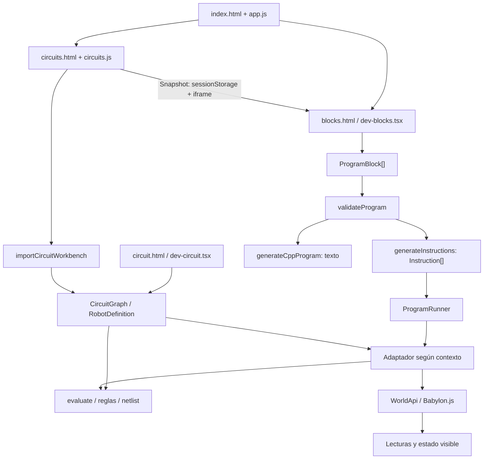

# ROBOKAN — contexto técnico del proyecto

Guía para entender el código actual, ejecutar el proyecto y localizar los archivos que intervienen en cada función. Distingue lo implementado de los objetivos y de la documentación antigua.

| Referencia | Valor |
| --- | --- |
| Carpeta revisada | `C:\Users\Gabriell\Downloads\ROBOKAN` |
| Fecha de revisión | 21 de noviembre de 2026 |
| Rama y commit consultados | `main` · `9cdd807` |
| Método | Revisión de código y documentos; no se ejecutaron builds ni pruebas para elaborar esta guía |
| Fuente de verdad | Código actual, contratos TypeScript y pruebas; las notas antiguas requieren contraste |

> `circuit.html` y `circuits.html` son interfaces diferentes. La portada abre normalmente **`circuits.html`**, la mesa estática. El nombre en singular identifica el editor React independiente.

## 1. Qué incluye actualmente

ROBOKAN es una aplicación educativa de robótica y electrónica en el navegador. Combina una portada estática, edición de conexiones, programación visual con Blockly y un entorno 3D con Babylon.js.

| Área | Estado observado |
| --- | --- |
| Portada | HTML/CSS/JavaScript, marca, robot y capturas reales de las interfaces |
| Mesa estática | Biblioteca de piezas, cables, selección, historial, guardado, evaluación y apertura de programación/mundo |
| Editor React de circuitos | Pantalla independiente basada en contratos y evaluación canónicos |
| Programación | Blockly, validación, generación de C++ y de instrucciones tipadas |
| Ejecución | Intérprete TypeScript con esperas, pausa, cancelación y adaptadores |
| Mundo 3D | Modelos GLB, robot ensamblado, cámaras, movimiento, sensores y actuadores educativos |
| Shell y misiones | Espacios reservados y documentación; no un sistema completo implementado |

El C++ mostrado **no se compila ni se ejecuta**: es una representación educativa. Lo que se ejecuta es una lista de instrucciones TypeScript. No se identificó un intérprete Python, un backend de cuentas ni almacenamiento de proyectos en la nube en esta implementación.

## 2. Ejecución y rutas

[package.json](package.json) requiere Node.js `^22.12.0 || ^24.0.0 || >=26.0.0`.

Desde PowerShell:

```powershell
Set-Location 'C:\Users\Gabriell\Downloads\ROBOKAN'
npm ci --ignore-scripts
npm run dev
```

Vite configura `127.0.0.1:5173`; puede escoger otro puerto si está ocupado. Utiliza la dirección que muestre la terminal, sin asumir que el puerto de una sesión anterior sigue siendo el actual.

| Ruta | Pantalla |
| --- | --- |
| `/` o `/index.html` | Portada |
| `/circuits.html` | Mesa estática enlazada desde la portada |
| `/circuit.html` | Editor React independiente |
| `/circuit.html?project=avoider` | Ejemplo evasor del editor React |
| `/circuit.html?project=line-follower` | Ejemplo seguidor de línea |
| `/circuit.html?project=blank` | Proyecto vacío |
| `/blocks.html` | Programación Blockly |
| `/blocks.html?example=motors&world=1` | Ejemplo de motores con mundo 3D |

Para revisar la salida compilada:

```powershell
npm run build
npm run preview
```

Antes de publicar hay que comprobar el riesgo de empaquetado descrito en la sección 13. Una compilación exitosa no demuestra que todas las rutas estáticas copiadas funcionen en el navegador.

## 3. Organización del repositorio

```text
ROBOKAN/
├─ index.html                  Portada
├─ app.js                      Comportamiento de portada
├─ style.css                   Hoja estática conservada por el empaquetado
├─ circuits.html               Mesa estática
├─ circuits.js                 Edición, guardado y puentes de esa mesa
├─ circuits.css                Diseño de la mesa estática
├─ circuits-art.js             Catálogo y dibujos SVG 2D
├─ circuit.html                Entrada React de circuitos
├─ blocks.html                 Entrada de programación
├─ package.json                Dependencias y comandos
├─ package-lock.json           Resolución de dependencias
├─ vite.config.mts             Entradas, servidor y copia de recursos
├─ tsconfig*.json              Configuración TypeScript
├─ assets/
│  ├─ home/                    Recursos/CSS propios de portada
│  └─ home-taste/              Sistema visual, movimiento y momentos
├─ public/models/              Recursos públicos del mundo
├─ src/
│  ├─ core/                    Contratos, IDs y eventos compartidos
│  ├─ dev/                     Entradas funcionales e integración actual
│  ├─ app/                     Shell reservado
│  └─ modules/
│     ├─ circuit/              Grafo, editor React y evaluación eléctrica
│     ├─ blocks/               Blockly, validación y generadores
│     ├─ runtime/              Intérprete
│     ├─ world/                Babylon.js, sensores y movimiento
│     ├─ components/           Catálogo visual y modelos GLB
│     ├─ robots/               Reservado
│     ├─ missions/             Reservado
│     └─ ui-kit/               Reservado
├─ tests/                      Pruebas de módulos e integración
├─ docs/                       Arquitectura, contratos y notas históricas
├─ odd/tasks/                  Registros de etapas anteriores
├─ .taste-skill/               Evidencia de diseño
└─ .codegraph/                 Índice auxiliar de código
```

Se omite el detalle de archivos internos de dependencias y recursos del kit visual. `node_modules/`, `dist/` y `raw-models/` están ignorados por Git en la configuración revisada. `dist/` es salida generada, no fuente para editar.

### Tecnologías

| Dependencia declarada | Función |
| --- | --- |
| React / React DOM `19.3.1` | Interfaces de circuitos, bloques y mundo |
| Blockly `^12.0.0` | Programación visual |
| Babylon.js Core / Loaders `^9.37.1` | Escena, GLB y consultas geométricas |
| Vite `8.3.8` | Desarrollo y compilación |
| TypeScript `7.0.2` | Contratos y comprobación de tipos |
| Vitest `5.1.1` | Pruebas TypeScript |
| Prettier `3.10.1` | Comprobación de formato |

Los rangos declarados no necesariamente coinciden con la versión resuelta. Para reproducir la instalación se utiliza [package-lock.json](package-lock.json).

## 4. Arquitectura y recorrido de los datos

Hay varias entradas HTML, no un router React global. Aunque estén en `src/dev/`, los archivos de esa carpeta sostienen las pantallas funcionales. [src/main.tsx](src/main.tsx) y [src/app/App.tsx](src/app/App.tsx) son espacios reservados, no el arranque general.



El recorrido central es **editar → validar → generar instrucciones → ejecutar mediante un adaptador → actualizar lecturas y mundo**. Geometría 2D, topología eléctrica, representación 3D y programa están relacionados, pero son objetos y formatos distintos.

## 5. Página principal

| Archivo | Responsabilidad |
| --- | --- |
| [index.html](index.html) | Estructura, navegación, robot, galería y pie |
| [app.js](app.js) | Pestañas/capturas, teclado y pausa/reanudación del robot |
| [assets/home/home.css](assets/home/home.css) | Composición adaptable, imágenes completas y animaciones propias |
| [assets/home/](assets/home/) | Capturas reales, logo, isotipo, robot y vista previa social |
| [assets/home-taste/](assets/home-taste/) | Sistema visual, interacción y momentos cargados por la portada |

Los originales suministrados permanecen en la raíz: `logotipo.png`, `robokan-isotipo.svg` y `robot.webp`. La portada usa copias dentro de `assets/home/`, como `brand-logo.png`, `brand-mark.svg` y `robot.webp`, para distribuirlas con sus recursos.

La revisión reciente siguió una referencia con panel izquierdo y robot protagonista a la derecha. Se sustituyeron los rótulos de marca por imágenes del logo, se retiró el rótulo gigante del pie y se añadió animación con pausa y soporte de movimiento reducido. Una actualización posterior colocó la captura suministrada del entorno 3D en ese espacio, con enlace al ejemplo de mundo, y extendió los mismos logos a las interfaces estática/React de circuitos y bloques. Los recursos se reutilizan desde `assets/home/`.

Las alturas naturales y las capturas completas evitan el recorte que antes produjeron alturas fijas y máscaras. [.taste-skill/home-plan.txt](.taste-skill/home-plan.txt) conserva el informe de esa intervención y su resultado `GATE: OPEN 11`: diferencias con reglas de plantilla, no un error de compilación ni una certificación funcional del proyecto actual.

Aquella intervención tenía como límite no modificar interfaces de circuitos/bloques. Sus recursos y estilos se mantuvieron separados de la portada. No debe suponerse que todo archivo existente bajo `assets/` está activo: hay material de iteraciones previas.

## 6. Los dos editores de circuitos

### Mesa estática: `circuits.html`

Es la pantalla a la que llega el usuario desde la portada.

| Archivo | Cómo participa |
| --- | --- |
| [circuits.html](circuits.html) | Paneles, biblioteca, mesa y diálogo de programación |
| [circuits.css](circuits.css) | Presentación específica |
| [circuits-art.js](circuits-art.js) | Exporta `componentTypes` y `artwork`: tipos visuales y dibujos |
| [circuits.js](circuits.js) | Estado, selección, arrastre, cables, escala, zoom, historial, guardado y apertura del iframe |

El snapshot visual tiene `components` y `wires`. Las piezas usan IDs como `uno-1`; un extremo de cable tiene forma `{ component, pin }`. Las posiciones y la escala pertenecen a esta representación.

La evaluación convierte ese snapshot mediante `importCircuitWorkbench`, llama al evaluador canónico y muestra violaciones/elementos sin alimentación. No es únicamente una etiqueta de simulación. Los límites observados son **60 componentes y 200 cables**.

### Editor React: `circuit.html`

[circuit.html](circuit.html) monta [src/dev/dev-circuit.tsx](src/dev/dev-circuit.tsx). Este mantiene una `RobotDefinition`, ejemplos y drives de prueba, e integra cambios del editor conservando los demás campos de la definición.

[CircuitEditor.tsx](src/modules/circuit/CircuitEditor.tsx) es controlado: recibe grafo/fichas y notifica cambios con `onChange`.

| Archivo de `src/modules/circuit/` | Función |
| --- | --- |
| [Canvas.tsx](src/modules/circuit/Canvas.tsx) | Presentación del lienzo |
| [Palette.tsx](src/modules/circuit/Palette.tsx) | Biblioteca de piezas |
| [Wire.tsx](src/modules/circuit/Wire.tsx) | Representación de cables |
| [interactions.ts](src/modules/circuit/interactions.ts) | Operaciones de edición y viewport |
| [pins.ts](src/modules/circuit/pins.ts) | Resolución geométrica de pines |
| [wiring.ts](src/modules/circuit/wiring.ts) | Conexiones, rutas e IDs de cables |
| [serialize.ts](src/modules/circuit/serialize.ts) | Formato canónico e importación validada |
| [i18n.ts](src/modules/circuit/i18n.ts) | Textos/nombres del módulo |
| [circuit.css](src/modules/circuit/circuit.css) | Estilos React |
| [index.ts](src/modules/circuit/index.ts) | Exportaciones públicas |

Los dos editores reutilizan conceptos y motor, pero sus formatos persistidos no se intercambian directamente. [import-circuit-workbench.ts](src/dev/import-circuit-workbench.ts) adapta explícitamente la mesa al core.

## 7. Core y evaluación eléctrica

### Contratos compartidos

| Archivo | Contrato o servicio |
| --- | --- |
| [core/contract.ts](src/core/contract.ts) | Piezas, pines, cables, circuito, robot, señales y estados |
| [core/instructions.ts](src/core/instructions.ts) | Instrucciones y resultados del adaptador |
| [core/ids.ts](src/core/ids.ts) | IDs y contadores que evitan reutilizarlos |
| [core/events.ts](src/core/events.ts) | Bus tipado y suscripciones |
| [core/index.ts](src/core/index.ts) | Entrada pública |

| Tipo | Significado |
| --- | --- |
| `ComponentSpec` | Ficha de un tipo de pieza, sus pines y características |
| `ComponentInstance` | Pieza concreta colocada en un circuito |
| `Wire` | Conexión entre referencias de pines |
| `CircuitGraph` | Piezas, cables y continuidad de IDs |
| `RobotDefinition` | Definición que añade chasis, placa y `programSource` |
| `PinRef` | Referencia `<instanceId>/<pinName>` |

Nombre visible, ID de instancia y `specId` no son equivalentes. El adaptador convierte identidades como `uno-1` a `arduino-uno:1` y traduce nombres de pines.

### Evaluación

`evaluate(graph, specs, drives)` combina construcción de redes, validación de señales aplicadas, reglas eléctricas y propagación de señales.

| Archivo | Papel |
| --- | --- |
| [netlist.ts](src/modules/circuit/netlist.ts) | Agrupa pines conectados mediante union-find |
| [breadboard.ts](src/modules/circuit/breadboard.ts) | Continuidad interna de protoboard |
| [rules.ts](src/modules/circuit/rules.ts) | Reglas educativas |
| [voltage.ts](src/modules/circuit/voltage.ts) | Drives, voltajes y propagación |
| [api.ts](src/modules/circuit/api.ts) | Evaluación, resolución de pines y publicación de cambios |
| [hardware-adapter.ts](src/modules/circuit/hardware-adapter.ts) | Puente entre instrucciones, condiciones eléctricas y mundo |

Las señales distinguen estados flotantes, digitales, analógicos y PWM. Los estados de componente incluyen `ok`, `unpowered` y `burned`.

El contrato contempla LED sin resistencia, polaridad invertida, ausencia de tierra común/alimentación, sobrevoltaje GPIO y pines flotantes. Se emiten eventos como `circuit:changed`, `pin:changed` y `component:burned`.

`createCircuitApi` recibe getters para leer el contexto vigente. Este motor es una evaluación de reglas educativas: no SPICE ni una simulación analógica continua.

## 8. Blockly y generación de C++

[blocks.html](blocks.html) monta [src/dev/dev-blocks.tsx](src/dev/dev-blocks.tsx), punto de integración de circuito, programa, adaptadores, controles, lecturas y mundo. Su hoja visual está en [dev-blocks.css](src/dev/dev-blocks.css).

| Archivo de `src/modules/blocks/` | Responsabilidad |
| --- | --- |
| [definitions.ts](src/modules/blocks/definitions.ts) | Unión de tipos `ProgramBlock` |
| [BlocksEditor.tsx](src/modules/blocks/BlocksEditor.tsx) | Workspace, toolbox, bloques/campos, orden, archivos y cambios pendientes |
| [validate-program.ts](src/modules/blocks/validate-program.ts) | Campos, IDs, pines y conflictos |
| [generate-instructions.ts](src/modules/blocks/generate-instructions.ts) | Bloques → instrucciones tipadas |
| [generate-cpp.ts](src/modules/blocks/generate-cpp.ts) | Texto Arduino educativo y auxiliares `robokan_*` |
| [program-file.ts](src/modules/blocks/program-file.ts) | Envelope versionado y validación de archivos |
| [program-snapshot.ts](src/modules/blocks/program-snapshot.ts) | Comparación estable de programas |
| [ReadingsPanel.tsx](src/modules/blocks/ReadingsPanel.tsx) | Lecturas y resultados |
| [index.ts](src/modules/blocks/index.ts) | API pública |

Del workspace se obtiene `ProgramBlock[]`. De esa misma representación se derivan validación, C++ e instrucciones. El texto C++ no es el programa ejecutado por el runner.

`program-snapshot.ts` excluye propiedades `editable`, `movable` y `deletable` de la comparación: cambiar permisos de Blockly no debe provocar por sí solo un aviso de contenido modificado.

### Siete instrucciones actuales

| Instrucción | Intención |
| --- | --- |
| `wait` | Espera con pausa/cancelación |
| `motor_write` | Velocidad de motor |
| `read_distance` | Distancia ultrasónica |
| `sensor_read` | Lectura de sensores compatibles |
| `digital_write` | Salida digital |
| `servo_write` | Orden de servo |
| `buzzer_write` | Control de buzzer |

Algunas notas antiguas hablan de cinco; el contrato actual contiene siete. La disponibilidad depende del contexto: sin mundo, la interfaz limita ejecutar a `wait`, `read_distance` y, fuera del modo de distancia de prueba, `digital_write`. No todos los bloques se pueden ejecutar en cualquier modo.

## 9. Intérprete y adaptadores

[ProgramRunner](src/modules/runtime/program-runner.ts) interpreta `Instruction[]`. Mantiene cursor, espera pendiente, órdenes activas, `AbortController` y época de ejecución. Sus estados incluyen `idle`, `running`, `paused`, `completed` y `error`.

| Acción | Comportamiento central |
| --- | --- |
| Ejecutar | Valida/copia instrucciones y comienza |
| Pausar | Conserva posición/tiempo y detiene motores |
| Reanudar | Continúa y restaura órdenes cuando corresponde |
| Detener | Cancela y aplica salidas seguras |

Expone lecturas, violaciones y errores. La entrada de bloques pausa cuando se oculta la pestaña; volver a verla no debe interpretarse como una orden de reanudación automática.

`dev-blocks.tsx` selecciona el adaptador:

| Contexto | Adaptador |
| --- | --- |
| Mundo preparado | `createExecuteHardwareInstruction` |
| Distancia de prueba | `createTestDistanceAdapter` |
| Modo normal sin mundo | `createCircuitProgramAdapter` |

`ExecuteHardwareInstruction` recibe una instrucción de hardware y un `AbortSignal`. Devuelve `completed`, `reading` o `electrical_error`. `wait` queda fuera de `HardwareInstruction`, pues el flujo de ejecución controla la espera.

Tener un modelo visible no equivale a estar conectado/alimentado. El adaptador comprueba condiciones eléctricas antes de aceptar las operaciones del mundo.

## 10. Mundo 3D y recursos

| Archivo de `src/modules/world/` | Función |
| --- | --- |
| [WorldViewport.tsx](src/modules/world/WorldViewport.tsx) | Creación/liberación React y controles visibles |
| [create-world.ts](src/modules/world/create-world.ts) | Engine, Scene, escenario, consultas, render, comandos y limpieza |
| [motion.ts](src/modules/world/motion.ts) | Cinemática diferencial y colisiones simplificadas |
| [robot-model.ts](src/modules/world/robot-model.ts) | Ensamblado según definición/montajes |
| [component-models.ts](src/modules/world/component-models.ts) | Caché por escena, instancias, materiales y liberación de GLB |
| [types.ts](src/modules/world/types.ts) | `WorldApi`, `RobotWorld`, comandos y snapshots |
| [index.ts](src/modules/world/index.ts) | API pública |

El escenario se carga desde `public/models/scenery/scene.glb` mediante `BASE_URL`. Se oculta el robot que trae el escenario y se ensambla el robot activo. Hay cámaras orbital, superior y de seguimiento, rayo ultrasónico y trayectoria.

### Dos catálogos con fines distintos

| Catálogo | Archivo | Contenido |
| --- | --- | --- |
| Visual | [components/models.ts](src/modules/components/models.ts) | GLB, tamaño, orientación y descriptores visuales |
| Eléctrico actual | [dev/circuit-fixtures.ts](src/dev/circuit-fixtures.ts) | `circuitSpecs`, pines, propiedades y ejemplos |

El catálogo visual contiene once modelos: chasis, rueda, Uno, Raspberry, ultrasónico, LED, motor, L298N, batería, protoboard y LM35. Añadir un GLB no añade automáticamente una ficha eléctrica ni un comportamiento.

`ComponentModelLibrary` carga una vez por escena y reutiliza geometría. Instancias, materiales y escenas tienen ciclo de liberación; un desmontaje no debe dejar recursos colgados.

### Sensores y movimiento

| Elemento | Modelo actual |
| --- | --- |
| Ultrasónico | Raycast contra obstáculos; distancia en centímetros |
| Fuego/gas | Funciones educativas basadas en distancia |
| Infrarrojo | Franja según posición X |
| LM35 | Temperatura sintética según proximidad a fuego |
| Movimiento | Cinemática diferencial, velocidades escaladas, subpasos y colisiones simplificadas |

El código actual sí lee LM35 mediante `sensor_read` y admite `servo_write`. Deben cumplirse las comprobaciones del adaptador. No es física mecánica completa ni una reproducción exacta de sensores reales.

## 11. Persistencia, formatos y comunicación

### Almacenamiento local

| Clave | Medio | Dueño/formato |
| --- | --- | --- |
| `robokan.circuit-editor.v1` | `localStorage` | Mesa estática: snapshot `components`/`wires` |
| `robokan.program.circuit-transfer` | `sessionStorage` | Snapshot para abrir programación desde la mesa |
| `robokan.circuit.v1` | `localStorage` | Editor React: `{ version: 1, graph: ... }` |
| `robokan.blocks.workspace.v1` | `localStorage` | Workspace Blockly por defecto |
| `robokan.blocks.workspace.v1.<programKey>` | `localStorage` | Workspace por placa/ejemplo |

El ejemplo de motores usa `world-motors` como clave de programa. Los sufijos separan programas asociados a contextos distintos.

El almacenamiento pertenece al origen del navegador: cambiar puerto, protocolo o dominio puede mostrar otro conjunto de guardados. Borrar datos del sitio elimina esos guardados. Puede fallar y no equivale a una cuenta ni a una copia en la nube.

### Conversión de la mesa al core

[importCircuitWorkbench](src/dev/import-circuit-workbench.ts) transforma `components` a `componentInstances`, tipos visuales a `specId`, IDs a nomenclatura canónica y extremos `{ component, pin }` a `PinRef`. Traduce nombres de pines, admite escala opcional de 0.5 a 1.5 y valida con `deserializeCircuit`.

No se debe copiar JSON de un editor al almacenamiento del otro esperando compatibilidad automática.

### Apertura de programación y mundo

`openBoardProgram(component, withWorld)` guarda un snapshot y abre `blocks.html` en un iframe. Utiliza parámetros como:

```text
circuit=1
embedded=1
board=arduino-uno:<n> o raspberry-pi-4:<n>
programKey=<id de placa en la mesa>
world=1  (si se solicita mundo 3D)
```

Para abrir el mundo se utiliza la placa seleccionada o una disponible según la lógica de la mesa. La entrada de bloques lee la transferencia al inicializarse.

Es una **transferencia de snapshot al abrir**, no sincronización continua universal del grafo entre ventanas.

| Mensaje | Función |
| --- | --- |
| `robokan:circuit-state` | Devuelve estados de componentes a la mesa |
| `robokan:request-close` | Inicia cierre respetando cambios pendientes |
| `robokan:close-allowed` | Confirma que se puede cerrar |

Los receptores revisados comprueban origen y ventana. Las ampliaciones del puente deben conservar esas verificaciones y el protocolo de cierre.

### Archivos importados/exportados

`program-file.ts` define un envelope versionado y solo admite los siete tipos conocidos. El parser incorpora un límite nominal de 1 000 000 para tamaño y un presupuesto de 10 000 objetos de estructura.

La importación del circuito canónico valida envelope, identidades, pines, catálogo, posiciones y límites. Un JSON no es válido únicamente por tener nombres de propiedades similares.

## 12. Pruebas y herramientas

| Comando | Alcance |
| --- | --- |
| `npm test` | Pruebas Node de portada y después Vitest excluyendo `.cjs` |
| `npm run test:circuit` | Patrón `tests/circuit-` |
| `npm run typecheck:circuit` | `tsconfig.circuit.json` sin generar salida |
| `npm run format:check` | Formato en rutas específicas de core/circuito/dev/pruebas enumeradas en el script |
| `npm run build` | TypeScript sin emisión y build Vite |
| `npm run preview` | Salida compilada para revisión local |

`format:check` no cubre automáticamente todos los archivos: hay que revisar las rutas declaradas en `package.json`.

En [tests/](tests/) hay grupos para contratos/reglas/API de circuitos, modelo del editor, navegación, adaptadores, generadores, Blockly, archivos/snapshots, paneles, runner, hardware, mundo y modelos. [home-menu.test.cjs](tests/home-menu.test.cjs) utiliza el runner Node. Algunas pruebas de modelos usan `NullEngine` y cargan GLB reales.

La guía no afirma que la suite o el build del commit revisado hayan pasado: para una comprobación funcional actual deben ejecutarse los comandos pertinentes.

| Carpeta auxiliar | Interpretación |
| --- | --- |
| `.codegraph/` | Navegación estructural de código; no runtime ni prueba funcional |
| `.taste-skill/` | Capturas/informes de diseño |
| `odd/tasks/` | Registros históricos; sus estados no sustituyen comprobar el código actual |

## 13. Build y riesgo de empaquetado

[vite.config.mts](vite.config.mts) usa base relativa `./`. Sus entradas compiladas declaradas son `circuit.html` y `blocks.html`.

El plugin `preserve-existing-static-assets` copia literalmente a `dist/`:

```text
index.html, app.js, style.css, favicon.svg,
circuits.html, circuits.js, circuits.css, circuits-art.js,
assets/**
```

Esto conserva la portada y la mesa estáticas junto a las entradas compiladas. Los recursos públicos y los modelos importados siguen sus respectivos recorridos de Vite.

### Punto pendiente antes de publicar

El `circuits.js` actual importa directamente:

```javascript
import { importCircuitWorkbench } from './src/dev/import-circuit-workbench.ts';
import { circuitSpecs } from './src/dev/circuit-fixtures.ts';
import { evaluate } from './src/modules/circuit/api.ts';
```

El plugin copia ese archivo sin transformarlo, la mesa estática no es una entrada compilada y la lista de copia no incluye `src/`.

**Inferencia a verificar:** en desarrollo Vite puede transformar esos imports TypeScript bajo demanda, pero la salida estática podría conservar referencias que no se distribuyen. Hay que ejecutar build/preview y abrir **`/circuits.html`**, revisar consola y solicitudes de módulos. Probar solo `/circuit.html` no verifica esta otra pantalla.

No había `dist/` al mapear el proyecto y no se ejecutó build en esta revisión. Se documenta una discrepancia pendiente de verificación, no una corrección aplicada ni un fallo reproducido en producción.

## 14. Límites y documentos antiguos

No deben sobreentenderse capacidades por el nombre de una carpeta:

- El catálogo eléctrico consumido sigue en fixtures de desarrollo.
- Catálogo GLB y catálogo eléctrico no son el mismo servicio.
- `src/app`, `src/main.tsx`, `robots`, `missions` y `ui-kit` contienen espacios reservados.
- Electrónica, sensores y movimiento utilizan aproximaciones educativas.
- El texto C++ no se compila/carga a una placa en este recorrido.
- Los guardados son locales; no se identificó un servicio de usuarios/proyectos en nube.

| Documento | Cómo utilizarlo |
| --- | --- |
| [README.md](README.md) | Introducción/comandos; algunas afirmaciones quedaron antiguas |
| [docs/arquitectura.md](docs/arquitectura.md) | Intención arquitectónica; contrastar con transferencia por snapshot actual |
| [docs/contrato.md](docs/contrato.md) | Contexto histórico; referencias a cinco instrucciones están desactualizadas |
| [docs/rol-2.md](docs/rol-2.md) | Notas de una etapa anterior, no inventario vigente |
| [docs/convenciones-nombres.md](docs/convenciones-nombres.md) | Glosario; contrastar tipos/nombres con el core |
| [docs/misiones.md](docs/misiones.md) | Objetivos, no evidencia de un motor terminado |
| [circuit/README.md](src/modules/circuit/README.md) | Conserva pendientes de mundo/runtime que ya tienen implementación |
| [components/README.md](src/modules/components/README.md) | La afirmación de LM35 únicamente visual quedó superada por lecturas actuales |

Licencias y procedencia: [ATTRIBUTIONS.md](ATTRIBUTIONS.md) y [assets/LICENSE](assets/LICENSE).

## 15. Dónde trabajar según el cambio

| Cambio | Punto de partida |
| --- | --- |
| Diseño de portada | `index.html`, `assets/home/home.css` |
| Capturas/marca/robot de portada | `assets/home/` y referencias HTML |
| Animación/pestañas de portada | `app.js`; conservar teclado y movimiento reducido |
| Mesa estática | `circuits.html`, `circuits.css`, `circuits.js`, `circuits-art.js` |
| Editor React | `src/modules/circuit/`, `src/dev/dev-circuit.tsx` |
| Protoboard | `breadboard.ts`, `netlist.ts` |
| Reglas eléctricas | `rules.ts`, `voltage.ts`, `api.ts` y pruebas |
| Tipo eléctrico | `src/dev/circuit-fixtures.ts`, contratos y adaptadores afectados |
| Nuevo bloque | Definiciones, Blockly, validación, generadores y pruebas |
| Nueva instrucción | Core, generadores, runner/adaptadores y pruebas; no solo el bloque visible |
| Pausa/espera/cancelación | `src/modules/runtime/program-runner.ts` |
| Sensor/actuador del mundo | `hardware-adapter.ts`, `world/types.ts`, `create-world.ts` y pruebas |
| Apariencia/modelos 3D | Catálogo visual, `component-models.ts`, `robot-model.ts` |
| Movimiento/colisión | `src/modules/world/motion.ts` |
| Guardado/importación | Formato específico del editor o `program-file.ts` |
| Distribución | `vite.config.mts`, entradas y rutas reales de `dist/` |

Una función visible atraviesa varias capas. Añadir un sensor exige alinear identidad/ficha, conexiones, bloque, instrucción, adaptador, modelo de lectura y presentación. Añadir solo su dibujo no completa ese recorrido.

## 16. Orden de lectura recomendado

1. [package.json](package.json), [vite.config.mts](vite.config.mts) y las entradas HTML.
2. [contract.ts](src/core/contract.ts) e [instructions.ts](src/core/instructions.ts).
3. [dev-blocks.tsx](src/dev/dev-blocks.tsx), como integración de programa, circuito y mundo.
4. Módulo afectado y sus pruebas; documentación histórica como contexto, no confirmación del estado.
5. Comprobaciones pertinentes y la ruta concreta que utilizará el usuario; para publicar, incluir el editor estático y su empaquetado.

Esta guía es una fotografía del commit indicado. Los contratos y comportamientos que cambien después deben contrastarse con el código antes de reutilizar este contexto.
