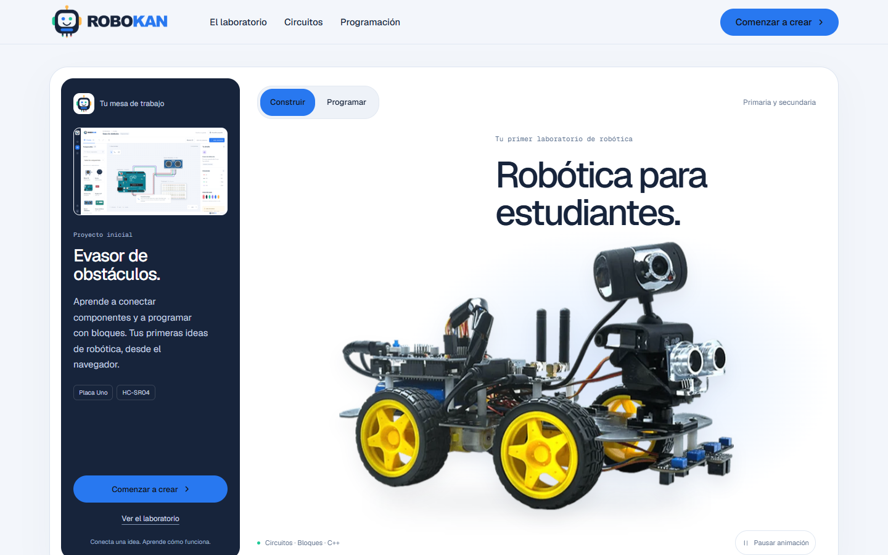
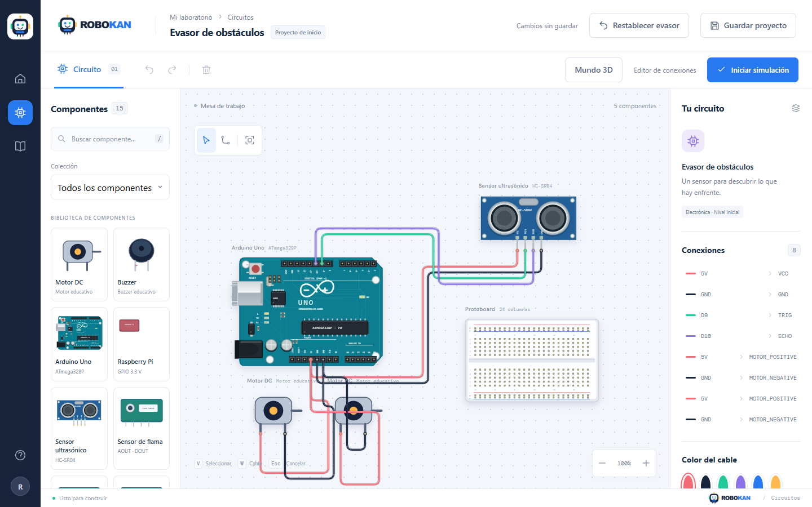
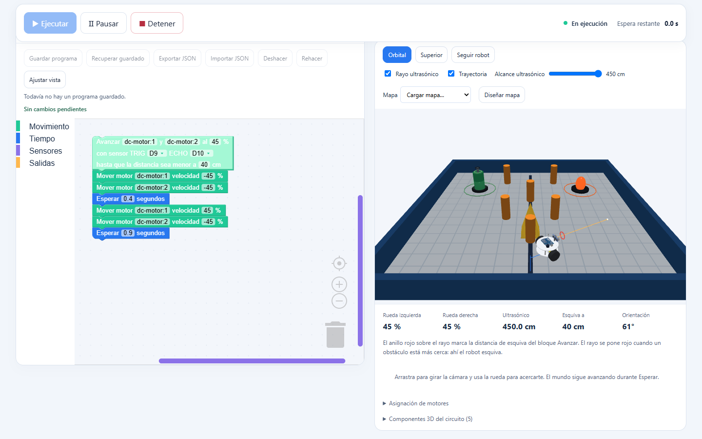
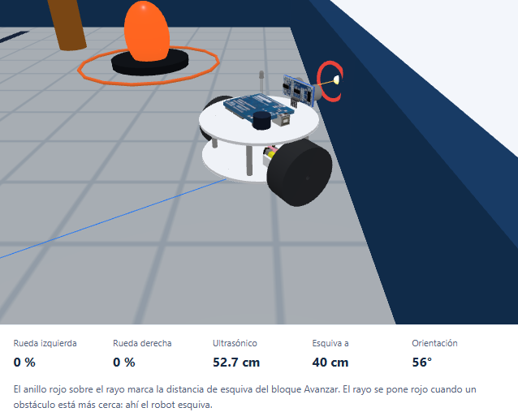
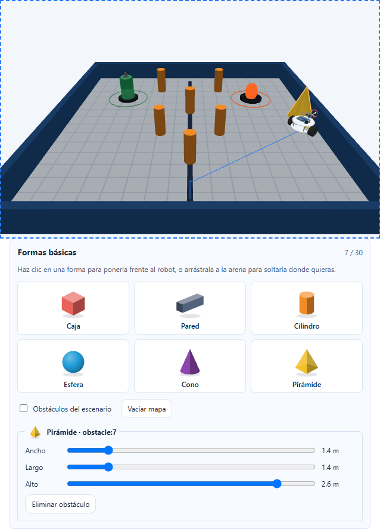

# ROBOKAN

**Tu primer laboratorio de robótica, gratis y en el navegador.**

ROBOKAN es una plataforma educativa para que niñas, niños y jóvenes de primaria y secundaria aprendan robótica y electrónica haciendo: conectan un circuito, lo programan con bloques y ven a su robot moverse en un mundo 3D. Todo en español, sin instalar nada y pensado para las computadoras que ya existen en las escuelas.



## ¿Por qué existe?

En el sur de México la robótica casi no se enseña en las escuelas. Los kits físicos son caros, se rompen, se pierden y requieren a alguien que ya sepa usarlos. ROBOKAN nace en Cancún, durante un hackatón, con una meta concreta: **que cualquier estudiante con una computadora y un navegador pueda construir y programar su primer robot**, y así sembrar el interés por la tecnología en quienes formarán la próxima generación de talento de la región.

Nuestros principios:

- **Gratis y sin cuentas.** No hay registro ni pagos. Los proyectos se guardan en el propio navegador.
- **En español** y con un lenguaje pensado para estudiantes.
- **Para equipos modestos.** Funciona en el navegador, sin instalar programas.
- **Se aprende equivocándose.** Los errores reales de electrónica tienen consecuencias en la simulación, igual que en un laboratorio, pero sin quemar nada de verdad.

## Cómo se aprende con ROBOKAN

Un solo robot recorre tres vistas: el circuito, el programa y el mundo. Lo que el estudiante conecta en el circuito es lo que su programa puede usar y lo que el robot tiene en 3D. Si un sensor no está conectado, el programa no puede leerlo, y eso también se aprende.

### 1. Conecta el circuito

En la mesa de trabajo se colocan placas, sensores y motores y se unen con cables, como en un laboratorio real. El proyecto de inicio, el **evasor de obstáculos**, ya viene armado: un Arduino Uno, un sensor ultrasónico y dos motores listos para funcionar.



Además del evasor, el selector **Ejercicio** trae circuitos básicos listos, cada uno con su reto: **Encender un LED**, **LED parpadeante**, **Semáforo** y **Medir distancia**. Los que usan la placa abren su programa ya preparado al programarla.

Al pulsar **Iniciar simulación** el circuito cobra vida sobre la mesa: el LED se enciende si está bien conectado y, si se conecta sin resistencia, se quema con una pequeña explosión. Si se invierte la alimentación el componente se daña y si falta una tierra común el sensor no responde. Cada error se explica en español para que el estudiante lo corrija.

### 2. Programa con bloques

Con bloques tipo Scratch el estudiante le dice al robot qué hacer: mover motores, esperar, leer sensores o encender salidas. El evasor trae listo su programa: **avanzar hasta que un obstáculo esté a menos de 40 cm, retroceder un poco, girar y repetir**. Cambiar ese número cambia a qué distancia esquiva el robot.

Junto a los bloques se puede ver el código C++ equivalente de Arduino, para que el paso al hardware real se sienta natural.



### 3. Pruébalo en el mundo 3D

El robot cobra vida en una arena 3D. El sensor ultrasónico mide de verdad la distancia a lo que tiene enfrente: el rayo amarillo muestra lo que "ve", un anillo rojo marca la distancia de esquiva y el rayo se pone rojo cuando un obstáculo está más cerca. Así se entiende *por qué* el robot gira.

Los ejercicios sin robot (encender un LED, el semáforo…) se ven en 3D como un circuito sobre la mesa: las piezas con sus cables de colores, los LEDs encendiéndose al ritmo del programa. Cualquier objeto 3D se puede arrastrar para acomodarlo, y en la biblioteca de formas también está el chasis del robot.



### 4. Diseña tu propio reto

Con **Diseñar mapa** cada estudiante crea su arena, como en una herramienta de modelado 3D: elige formas (caja, pared, cilindro, esfera, cono, pirámide), las coloca, las estira y mueve el robot a donde quiera empezar. También hay mapas listos con un clic, como el de columnas, el zigzag de paredes o el pasillo, ideales para una clase o una demostración.



## Proyecto de inicio: el evasor de obstáculos

Al pulsar **Comenzar a crear** se abre el evasor completo: circuito conectado y programa precargado. Basta con abrir **Mundo 3D** y pulsar **Ejecutar** para ver al robot recorrer la arena y esquivar lo que encuentra. Si alguien modificó el proyecto, el botón **Restablecer evasor** lo devuelve a su estado inicial.

Desde ahí, el camino de aprendizaje es natural:

1. **Observa:** ejecuta el robot tal como viene.
2. **Modifica:** cambia la velocidad, la distancia de esquiva o el giro.
3. **Conecta:** rehace el cableado y descubre qué pasa si algo falta.
4. **Diseña:** crea tu propio mapa y reta al robot.

## Lo que viene

ROBOKAN está en desarrollo. Las siguientes metas del equipo son:

- **Misión detector de fuga de gas**: un sensor MQ-2, un zumbador y un LED que avisan de una fuga, un problema real en los hogares mexicanos que usan gas LP. El sensor de gas ya funciona en el mundo 3D; falta la misión guiada.
- **Robot seguidor de líneas** como segunda plantilla.
- **Más misiones guiadas** con metas, niveles de ayuda y retroalimentación.
- **Raspberry Pi** con soporte completo (hoy el soporte principal es para Arduino Uno).
- **Uso sin conexión** para escuelas con internet limitado.

## Pruébalo

Necesitas [Node.js](https://nodejs.org/) 22.12+, 24 o 26+.

```bash
npm ci --ignore-scripts
npm run dev
```

Abre la dirección que muestre la terminal (normalmente `http://127.0.0.1:5173`) y pulsa **Comenzar a crear**.

Para conocer el funcionamiento interno (arquitectura y contratos entre módulos) consulta la carpeta [docs/](docs/). Las pruebas se ejecutan con `npm test`.

## Equipo y créditos

ROBOKAN es un proyecto de un equipo de cinco personas desde Cancún, México, creado para un hackatón con la ilusión de llevar la robótica a más salones de clase.

Los modelos 3D, tipografías y recursos de terceros se registran con su origen y licencia en [ATTRIBUTIONS.md](ATTRIBUTIONS.md). La licencia del código del proyecto está pensado para funcionar como un OpenSource con posibilidad de recibir donativos
